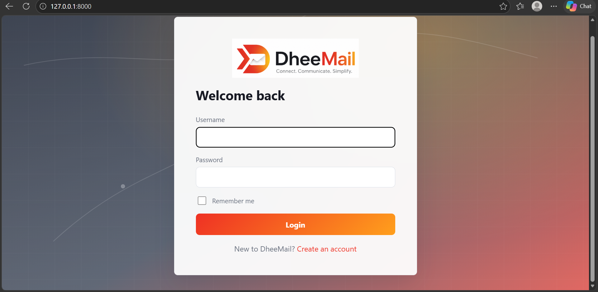
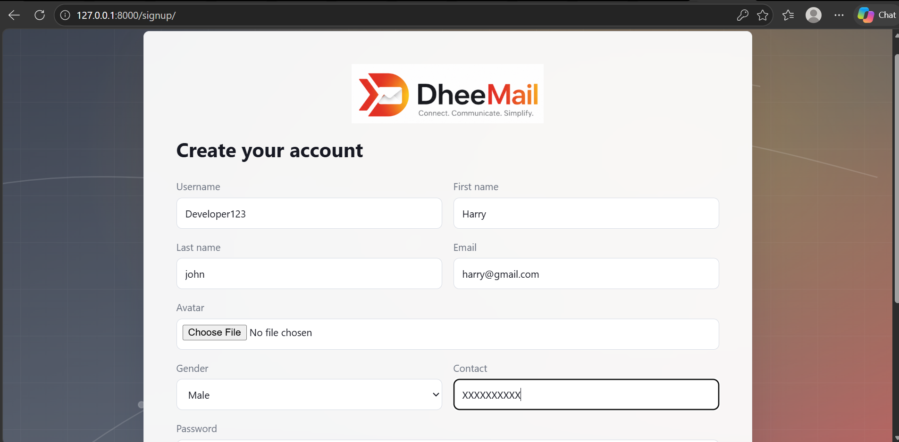
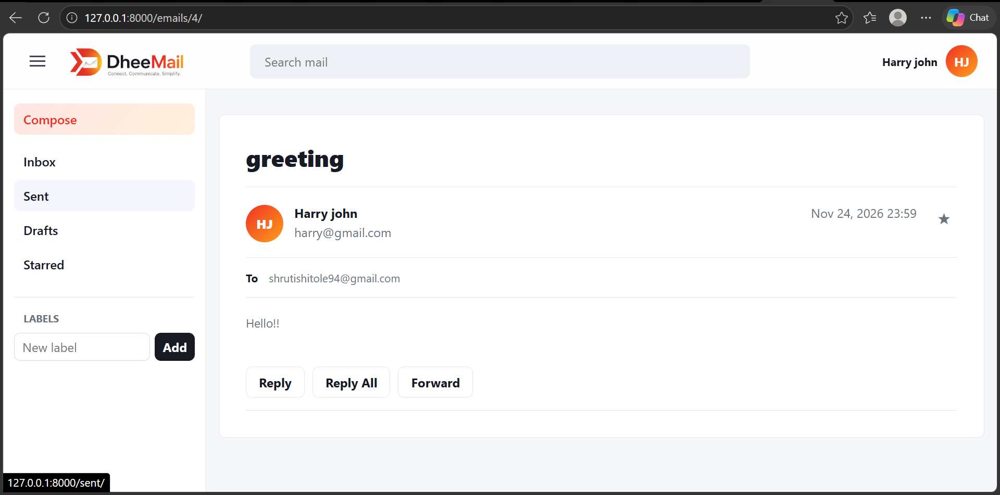

# DheeMail

A web-based email management system built with Django. Users can create an account, log in, send and receive emails, and see their important emails first.

## Features

- Create an account and log in securely
- Compose and send emails
- Receive emails in your inbox


## Tech Stack

Python, Django, HTML, CSS, JavaScript, SQLite

## Getting Started

1. Clone the repository and open the project folder:

   ```
   git clone https://github.com/ShrutiShitole05/dheemail.git
   cd dheemail
   ```

2. Create and activate a virtual environment:

   ```
   python -m venv .venv
   .venv\Scripts\activate
   ```

   On macOS/Linux, use `source .venv/bin/activate` instead.

3. Install the dependencies:

   ```
   pip install -r requirements.txt
   ```

4. Set up the database:

   ```
   python manage.py migrate
   ```

5. Start the server:

   ```
   python manage.py runserver
   ```

6. Open `http://127.0.0.1:8000/` in your browser and create an account to get started.

## Screenshots

### Login


### Sign up


### Email view


## Project Structure

- `dheemail/` - project settings and URLs
- `mailapp/` - main app (models, views, logic)
- `templates/` and `static/` - HTML, CSS, JavaScript

## Author

Shruti Shitole
[LinkedIn](https://linkedin.com/in/shruti-shitole-0447372a8) | [GitHub](https://github.com/ShrutiShitole05)